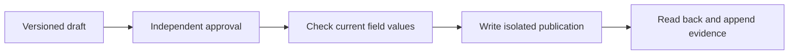

# GraviQuest Content Promotion and Versioning

Every saved change creates a numbered revision with the original values, proposed values, author and time. Significant transitions append events. Editing a proposal replaces its active revision and invalidates any prior approval. Reviewing a change records the exact revision. Saving the change does not replace a public page or change a production database.

## Rehearse and restore

1. Sign in as a staging editor and save a grouped visual change.
2. As an independent reviewer, move it through validation and QA, record an evidence note and approve the exact revision.
3. As a staging rehearsal manager, select **Publish to isolated preview**. Publication locks the target page, compares each current field against its captured base, writes the approved fields together, refreshes the row and records readback.
4. Open **Open isolated publication**. The authenticated readback is separate from the public website and existing CMS.
5. Select **Draft a restoration**, submit it, and repeat independent approval and isolated publication. The restoration creates auditable evidence and marks the original as restored.
6. If the current value differs, stop with `visual_base_conflict`. Create a new proposal from the current target. A stale browser sequence cannot apply a second release.

The code path uses exact-SHA CI and the guarded staging and production Actions. The visual rehearsal path exercises field-level conflict, promotion and rollback without a production connection. Production needs a separate narrow control mechanism, a trusted production base/readback, verified independent authorization, immutable asset mapping and protected workflow execution. Grouped mixed code/content release, authored scheduling, and production deployment progress are pending.

Track related work on the existing development task. See the [Release Center](release-center.md), [Visual Editor](visual-editor.md), and [release guide](development-and-release-workflow.md).
