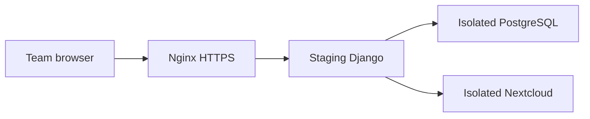
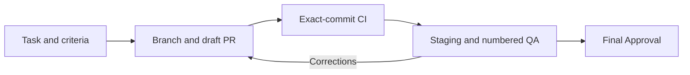

# GraviQuest — Development, Staging & Production Release Guide

## Environments

See [Staging Architecture](staging-architecture.md) for the measured service topology and sizing, and [Staging Feature Parity](staging-feature-parity.md) for test paths and evidence.

[Production](https://graviquest.com/) serves the public site and Workspace V1. [Staging](https://staging.graviquest.com/workspace-v2) is the shared QA environment. Its current release is Workspace V2 `c98c7ac358ae2869aa739751ab894f055cc56efa` for [draft PR #406](https://github.com/hsdarestani/gravitas/pull/406) and Development task #1167 in Platform Development #212. Keep that release active for the current human QA session.

The workflows in this change are staged for repository review. An isolated [observation run](https://github.com/hsdarestani/gravitas/actions/runs/45966038562) verified the existing staging origin and named owner without switching revisions. Revision selection, deployment, acceptance, and the new production gate are available for manual dispatch from `main` after the workflows are approved and installed. The workflow links below show the draft source.



The staging virtual host proxies Django to loopback port 18000, PostgreSQL uses 15432, and Nextcloud uses 18081. Workspaces share canonical data **within the same environment**. Staging uses its own database and role, Nextcloud instance and volumes, application user, settings and secrets, host-only cookies, temporary local mail capture, cache namespace and Team Folder worker. The staging origin sends `X-Robots-Tag: noindex`; the candidate also serves a disallow-all `robots.txt`. Search uses the staging data store. External AI, forum writes, Open edX, and messaging integrations require independently scoped staging services and credentials. The production host, its services and credentials have their own release path.

The authorized host audit on 2026-11-27 found 6 logical CPUs, 0.65/0.42/0.39 load average, 3,952 MiB of 7,855 MiB RAM available, 1,628 MiB of 6,144 MiB swap free and 131,171 MiB disk free (45% used). PostgreSQL and Nextcloud staging containers and the Django service were running. This is sufficient for the existing topology and static site routes. The swap usage and shared host capacity rule out treating this snapshot as headroom for another full forum or Open edX installation. Use the [host preflight evidence](https://github.com/hsdarestani/gravitas/actions/runs/45845894550/attempts/2) and check fresh capacity before expanding the stack.

| Area | Current evidence and testing path |
| --- | --- |
| Workspace V1, Core Team | Staging Team UI reachable. Use the named staging owner, then test with a temporary member and a restricted user. |
| Workspace V2 | Live [preview](https://staging.graviquest.com/workspace-v2). PR #406 remains on human QA. Check cross-version task edits using one synthetic task, reload both versions, and check history and role visibility. |
| Nextcloud documents | Isolated instance and Team Folder workflows verified in [live acceptance](https://github.com/hsdarestani/gravitas/actions/runs/45875356292). Test upload, same-origin sign-on, an allowed user's download and revision history, and a denied user's access. |
| Django APIs and migrations | Live health and anonymous access boundary verified. Run Platform CI, including migration drift; rehearse migrations against a disposable staging backup. |
| Public frontend, Topics, Essays, Labs, Education | The current virtual host returns 404 for these pages. The candidate keeps public forms and API connections on the staging origin and adds a page allowlist at `/`, `/site`, `/topic-answer-that-looked-right.html`, `/lab.html` and `/education.html` plus related pages. When activated, verify static rendering, mobile navigation and local simulation behavior against the staging origin. |
| Research, CMS, publishing, Lab Studio, learning progress | Exercise authenticated endpoints with synthetic drafts and test roles after the candidate is active. Live publishing and permissions acceptance for these surfaces is pending. |
| Pulsar, Discourse, Open edX, payments and external notifications | Live external calls are unavailable in this staging topology. Test local behavior with CI mocks. End-to-end testing needs isolated provider credentials, quotas and test recipients, a separate forum/LMS service, or payment sandbox credentials as applicable. |

## Start a development task

Use Platform Development #212. Search open tasks for the same scope before creating records. Reuse Development task #1167 and its existing milestone records for Workspace V2. Record the owner, problem, acceptance criteria, dependencies, scope, draft PR, preview URL and SHA, numbered QA evidence, correction links, Final Approval decision and production verification. Keep each stage in its existing task or subtask.



Use `feat/` for product features, `fix/` for corrections and `ops/` for infrastructure. Use independent branches for concurrent work and one PR per tracked scope.

```sh
git fetch origin
git switch -c feat/example origin/main
git add <changed-paths>
git commit -m "Describe the change"
git push -u origin feat/example
gh pr create --repo hsdarestani/gravitas --base main --draft --title "Describe the change" --body-file /tmp/pr-body.md
```

Include acceptance steps, data changes and rollback dependencies in the PR. Link it from the existing task.

## Validation

From the repository root, run focused tests while editing. The [GraviQuest Platform CI](../.github/workflows/platform-ci.yml) workflow runs Django's Core suite, migration drift and system checks, JavaScript tests, and staging release safeguards against the selected head. Existing domain workflows still apply.

```sh
python3 -m venv .venv
.venv/bin/pip install -r backend/requirements.txt
PYTHONPATH=backend DJANGO_SETTINGS_MODULE=gravitas_backend.test_settings .venv/bin/python -m django test core
PYTHONPATH=backend DJANGO_SETTINGS_MODULE=gravitas_backend.test_settings .venv/bin/python -m django makemigrations core --check --dry-run
python3 -m unittest discover -s ops/staging -p 'test_*.py'
node --test tests/science-evidence.test.cjs tests/science-evidence-integration.test.cjs tests/science-universe-original.test.cjs tests/science-pulsar-scenarios.test.cjs
node scripts/preview-server.mjs --api off
```

## Configure and use shared staging

First configure the existing GitHub `workspace-staging` environment with a dedicated staging SSH private key, host and verified host-key line under `GQ_STAGING_SSH_KEY`, `GQ_STAGING_SSH_HOST` and `GQ_STAGING_KNOWN_HOSTS`. Use the previously provisioned owner email and password secrets only for authenticated smoke testing. Do not duplicate them in other environments. Configure the `staging-final-approval` environment with accountable required reviewers, self-review disabled and only `main` allowed. Restrict the `workspace-staging` environment to `main`. On the verification run, all three dedicated SSH settings were missing and owner authentication passed.

The infrastructure owner installs the reviewed host-side commands from the candidate. Use a separate SSH user `gq-stage-deploy` with password sign-in disabled. Set the public-key entry's options to `restrict,command="/usr/local/lib/gravitas-staging/ssh-command"`. Use `visudo -f /etc/sudoers.d/gq-stage-deploy` to restrict that account to `gq-stage-deploy ALL=(root) NOPASSWD: /usr/local/lib/gravitas-staging/release.sh`. The forced command accepts only `inspect`, `deploy` and `rollback` with validated arguments. It requires the pinned staging service, database, worker and virtual host.

```sh
sudo ./ops/staging/install-operator.sh /secure/path/gq-stage-deploy.pub
```

One release at a time can occupy staging. Record the QA owner, current SHA, deadline and requested next slot in the existing task. The current QA owner explicitly releases the slot. Only then does the infrastructure owner create the root-owned mode `0600` file `/etc/gravitas-workspace-staging/qa-release` containing the exact currently deployed SHA. A successful switch consumes it. If QA is in progress, queue the request and continue CI or disposable local testing.

```sh
printf '%s\n' "$CURRENT_STAGING_SHA" | sudo install -o root -g root -m 0600 /dev/stdin /etc/gravitas-workspace-staging/qa-release
gh workflow run platform-staging.yml --repo hsdarestani/gravitas --ref main \
  -f operation=deploy -f source=pr -f revision="$PR_NUMBER" \
  -f expected_current_sha="$CURRENT_STAGING_SHA" -f ci_run="$CI_RUN_ID"
```

Use `-f source=branch -f revision="$BRANCH"` to pin the current branch head, or `-f source=sha -f revision="$CANDIDATE_SHA"` for a known commit. Only repository-owned open PRs are accepted. The [Deploy GraviQuest to Staging](../.github/workflows/platform-staging.yml) workflow checks exact-commit CI, uses a pinned SSH host key and verifies the origin after switching. Deploy from the Actions workflow on `main`, even when the selected source is a feature branch. The signed-in `/api/staging/release/` endpoint identifies the candidate commit, reference, deployment time, status and Actions run. The legacy preview's active SHA is documented above.

## Accounts and fixtures

Use [staging login](https://staging.graviquest.com/login) and open [Core Team](https://staging.graviquest.com/workspace/core/team). The staging owner can create or add a teammate, assign a role, deactivate access and set a temporary password through the existing account service. Select the temporary-password method and share the credential through the team's secure channel. The staging mail backend captures outgoing mail in process. For the existing V2 preview, use Core Team to provision the account and then open V2 in the same session. Direct V2 onboarding requires deployment of the V2 integration and human verification.

Keep named staging accounts, QA tasks and their history persistent. Use synthetic test users, projects, reports, and harmless attachment files. For repeating demo tasks, use the existing `seed_workspace_demo` command with a dedicated staging user under the staging Django settings. Its `--remove` flag targets seeded objects for that account; keep QA records in separate projects. For content QA, run `python -m django staging_content_fixture qa-005 --owner "$STAGING_ADMIN_EMAIL"` under the staging systemd service environment, then use the synthetic Topic, Lab and course in their normal admin UI. Add `--remove` to remove untouched drafts only. Edited, published or enrolled records stay in normal QA history. Use an explicitly approved, sanitized snapshot only when synthetic data cannot reproduce the issue. Refreshes are separate scheduled changes with a backup and restore review.

## Human QA and approval

Each iteration records its number, exact SHA, preview URL, test identities by role, cases, resulting URLs or screenshots, defects and reviewer. Run corrections as a new iteration with a fresh CI run and deployment evidence. For QA 004, sign in as the named owner, confirm Core Team and Workspace V2, test a second role, review an existing synthetic task in both UIs, and check the Nextcloud SSO, ACL and revision controls. Record the Version 24 visual comparisons and outstanding issues on #1167. Do not record Final Approval while required QA gaps remain.

After reviewing every required case, open and approve the separate staging environment job and link its artifact to the task. The run records only acceptance of the SHA that remains active at staging.

```sh
gh workflow run platform-staging.yml --repo hsdarestani/gravitas --ref main \
  -f operation=accept -f source=sha -f revision="$ACCEPTED_SHA" \
  -f expected_current_sha="$ACCEPTED_SHA" -f ci_run="$CI_RUN_ID" -f qa_reference=1167/QA-004
```

Obtain permission to merge separately. Use protected `main` with required CI and reviewer approval. If the selected merge strategy creates a different commit, validate and accept the new exact SHA on staging before a production run. Schedule this in the shared staging queue.

## Production release and verification

Configure the GitHub `production` environment with protected `main` only, accountable required reviewers, self-review disabled and reviewer bypass disabled wherever available. Set `PRODUCTION_DEPLOY_HOST`, `PRODUCTION_DEPLOY_USER`, `PRODUCTION_DEPLOY_PORT` when non-default, and `PRODUCTION_DEPLOY_SSH_KEY` in that environment. The [Deploy Gravitas to Strato](../.github/workflows/deploy.yml) draft preserves the existing deployment, checkpoints and smoke checks and replaces main-push deployment with a manual, human-reviewed gate. The workflow checks current `main`, the same CI and staging acceptance SHA, and the protected environment before deployment. Inventory and govern the other production-capable workflows during the authorized cutover. The legacy `DEPLOY_*` credential paths in `backend-recover.yml`, `forum-activation.yml`, `nextcloud.yml`, `install-openedx.yml` and the Science Universe release workflows have separate triggers and purposes. Account for their write permissions before relying on the central production gate.

```sh
gh workflow run deploy.yml --repo hsdarestani/gravitas --ref main \
  -f release_sha="$MAIN_SHA" -f ci_run="$CI_RUN_ID" -f acceptance_run="$STAGING_ACCEPTANCE_RUN_ID"
curl -fsS https://graviquest.com/api/health/
```

After the production reviewer approves the job, confirm the deployed SHA, health, database, public URLs, and authorized signed-in Workspace V1 and changed feature paths. Confirm alerting and jobs if touched. Attach the deployment and verification evidence to the tracking task, then mark Done. Emergency hotfixes use a dedicated `fix/` branch, a reserved staging slot, exact-commit CI, focused human QA and Final Approval on the same gates.

## Migrations, backups and rollback

Generic staging switches validate migrations without applying them. For a schema change, review a migration plan under the staging account and settings and confirm old and new code can run against the upgraded schema. Schedule it as a separate operator change; capture staging DB, Nextcloud data and configuration checkpoints before applying. Use restrictive permissions and a confirmed stage-only target.

```sh
sudo install -d -o root -g root -m 0700 /var/backups/gravitas-workspace-staging
sudo sh -eu -c 'umask 077; docker exec gravitas-workspace-staging-postgres pg_dump -U postgres -Fc gravitas_workspace_staging > "/var/backups/gravitas-workspace-staging/$(date -u +%Y%m%dT%H%M%SZ).dump"'
sudo systemd-run --wait --pipe --collect -p User=gq-workspace-stage \
  -p EnvironmentFile=/etc/gravitas-workspace-staging/application.env \
  -p "WorkingDirectory=/opt/gravitas-workspace-staging/releases/$CANDIDATE_SHA/source/backend" \
  "$STAGING_VENV/bin/python" -m django migrate --plan
```

Check `pg_restore --list` and rehearse restoring into a disposable staging database. The `sudo ./ops/staging/host-maintenance.sh rehearse` command validates scope, archives the stage-only databases and Nextcloud files and verifies restoration in a networkless temporary container. For Nextcloud, coordinate a consistent staging-only DB and storage checkpoint with the infrastructure owner. An app rollback keeps the current database and files; proceed only when the targeted code is compatible with their schemas. Never restore staging backups over production. The production workflow owns its checkpoint logic in `ops/canonical_checkpoint.py` and writes production backups under `/var/backups/gravitas` and `/var/backups/gravitas-canonical`.

When a managed staging revision fails its origin checks, the host attempts to restore the previously working staging unit, Nginx routes and timer. After a completed deploy, a deliberate rollback selects a previously managed SHA and requires a fresh slot release.

```sh
gh workflow run platform-staging.yml --repo hsdarestani/gravitas --ref main \
  -f operation=rollback -f source=sha -f revision="$PREVIOUS_MANAGED_SHA" \
  -f expected_current_sha="$CURRENT_STAGING_SHA" -f ci_run="$PREVIOUS_CI_RUN_ID"
```

The legacy Workspace V2 preview predates this tooling. Before the first activation, capture its exact unit, vhost, timer configuration and working directory as a root-owned legacy checkpoint and verify an operator recovery procedure. The workflow's rollback requires a prior managed revision with compatible dependencies and CI evidence. Switching or rolling back the live preview was deferred to preserve active QA.

## Troubleshooting and acceptance

| Signal | Inspect or resolve |
| --- | --- |
| HTTP 503 | Check `systemctl status gravitas-workspace-staging`, `journalctl -u gravitas-workspace-staging`, loopback 18000 and the stage Nginx error logs; check health, DB and Nextcloud endpoints separately. |
| SSH job rejects the command | Check the three staging environment secrets, enrolled forced key, host fingerprint, root-managed paths, QA release file mode and exact active SHA. |
| Workflow missing from Run workflow | GitHub requires `workflow_dispatch` in the default branch. Review and approve the draft workflow before using it. |
| 401 or 403 on Team | Verify the named account is active, logged in to the staging hostname, and has the required Core role. Use temporary password reset if needed. |
| Different release SHA or migration pending | Stop before switching. Reconcile the reference and CI evidence or plan an isolated, compatible schema change. |

- **Developer** — Record exact scope and criteria, validate CI for the SHA, use synthetic fixtures, link the draft PR and avoid shared QA or production updates without release authorization.
- **QA owner** — Check desktop and mobile, representative roles, persistence and relevant external boundaries. Link the numbered evidence and hold or release the staging slot.
- **Release owner** — Verify same-SHA CI and QA, protected approval, current backups and rollback compatibility. Review and record production smoke results only after an authorized release.
