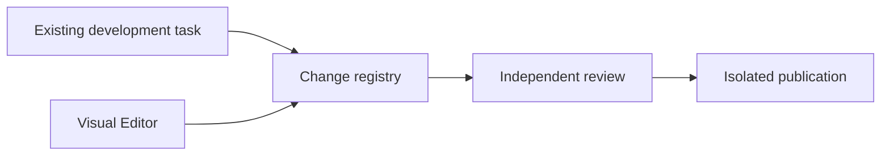

# GraviQuest Release Center

The Release Center adds a staging-first change registry inside the Workspace administration shell. The candidate route is `/workspace/core/releases`. Enable `GQ_STAGING_RELEASE_CENTER_ENABLED=1` in the existing staging application environment only after staging has applied the additive migrations and the QA owner has released the slot. The feature flag defaults off.

| Capability | Server permission | Behavior |
| --- | --- | --- |
| Visual editor or developer | `core.author_release_change` | Register development changes, save new visual revisions, submit and draft restorations. |
| QA reviewer | `core.review_release_change` | Start validation, record QA evidence, review, approve, reject or request corrections. An author cannot review their own change. |
| Release rehearsal manager | `core.rehearse_release_change` | Publish the exact approved revision to the isolated content rehearsal target. |

Use Django permissions or groups and existing Core membership. The API also checks visibility of a linked task. A staging application role does not grant production authority. The same-origin APIs require CSRF for write operations and sequence numbers for stale update protection.

## Register and review

In **Register development change**, provide the existing task ID, proposed Git SHA and PR number. Where applicable, also capture the previous SHA. This metadata does not import or modify GitHub issues and does not create a new development record. A reviewer moves a submitted change through **Start validation → Ready for QA → Start review → Approve**. The development **Ready for QA** step checks a successful same-repository Platform CI run for the exact proposed SHA. An approval records the current revision number and reviewer. Updating the proposal creates a new revision and clears approval.

Visual revisions show a field-by-field comparison and authenticated preview. Inspection includes the audit history and previous payloads. A conflicting published property returns `visual_base_conflict` and the author must prepare a new draft against the new base. Use [Visual Editor](visual-editor.md) for page coverage and [Content Promotion and Versioning](content-promotion-and-versioning.md) for the isolated publish and rollback flow.

## Release authority and evidence

The dashboard reads the two application health endpoints and the authenticated staging metadata if installed. A production commit with no verified release evidence is shown as unverified. This candidate has no production dispatch credential. Production workflow dispatch, scheduling, deployment progress, code rollback and production content readback require the separately authorized release control integration and a verified rehearsal. Existing GitHub Actions remain the guarded deployment path. See the [release guide](development-and-release-workflow.md).

For existing Workspace V2 QA, record evidence and the slot release in task #1167. Preserve PR #406 and use the combined Workspace V2, staging and account candidate after the owner releases QA 004.
