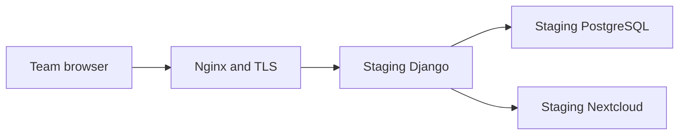
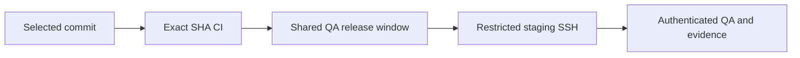

# GraviQuest — Staging Architecture

## Current topology

The GraviQuest production and staging origins share an existing STRATO host. The Workspace V2 QA deployment stays on `c98c7ac358ae2869aa739751ab894f055cc56efa` until the QA owner releases the staging slot. The public frontend routes are active on the retained staging revision. The managed revision switch, authenticated release metadata and fixture command are in [draft PR #409](https://github.com/hsdarestani/gravitas/pull/409).



| Component | Production | Staging and observed difference |
| --- | --- | --- |
| DNS, Nginx, TLS | `graviquest.com`, `forum.graviquest.com`, `cloud.graviquest.com`, `learn.graviquest.com`, `studio.graviquest.com` | `staging.graviquest.com` has its own HTTPS vhost and valid certificate. Backends bind to loopback. The public website is live at `/site`. The staging root still redirects to `/workspace-v2` to preserve the existing QA launch path. The managed candidate can place the public site at `/` after the slot changes. |
| Django and worker | `gravitas-backend.service`, loopback 8000; canonical, report, research and notification timers | `gravitas-workspace-staging.service`, loopback 18000, dedicated Linux user, 640 MiB and 75% of one CPU caps. The staging Team Folder and canonical sync worker has its own timer. The separate legacy `gravitas-backend-staging.service` on 8001 does not serve this preview. |
| PostgreSQL | Host PostgreSQL 18.6 on loopback 5432 | Container PostgreSQL 18.7 on loopback 15432, independent databases and roles `gravitas_workspace_staging` and `workspace_staging_nextcloud`, 384 MiB cap. Match major version and test migrations against this engine. |
| Nextcloud and caching | Nextcloud 34.0.5, loopback 8081, its own PostgreSQL 16 and Redis 7 containers | Nextcloud 34.0.5, loopback 18081, isolated database and file volume, 768 MiB cap, separately scoped SSO. No shared Redis. Django staging cache is local to its process. Redis parity for file locking and separate workers remains open. |
| File and object storage | Nextcloud, production media paths, local object storage service | Isolated Nextcloud volume and app paths under `/var/lib/gravitas-workspace-staging`. A dedicated staging S3 endpoint, buckets and IAM are pending. |
| Discourse | `graviquest` container, local Discourse image with its own services | No isolated instance. Candidate forum page explains how to request the test path; stage navigation stays on staging. |
| Open edX | Tutor, Open edX 22.0.2 Indigo, Caddy, LMS and CMS with workers, MFE, MySQL, Redis, MongoDB, Meilisearch and SMTP | No isolated Tutor project. Draft native course fixtures are available separately from Tutor. |
| External integrations | Pulsar providers, GitHub, Google OAuth, notifications and LMS payment handoff | Preexisting stage Nextcloud OIDC is scoped to the staging origin. Cash checkout and payment webhooks are blocked in the candidate pending a sandbox. Email is captured in process. Telegram, production forum, live AI providers, GitHub write integrations and production OAuth credentials are disabled or absent. |
| Monitoring | Host health watcher, production backups, Nextcloud, forum and object-store timers | Existing stage health, Team Folder timer and PostgreSQL/Nextcloud status. Host audit captures systemd, containers, memory, disk, loopback listeners, release SHA and healthy origins. The candidate adds the credential-free GitHub Staging Availability Monitor. Continuous host metrics, integration alarms and independent off-host staging backups are pending. |

Production and staging do have different host manifests, PostgreSQL patch releases and Nextcloud database/cache topologies. The release workflow pins an immutable Git commit as the shared source artifact. The host prepares an installation using the current requirements lock when compatible. Packaging and promotion of the same build artifact remain future work. See the [Twelve-Factor dev/prod parity guidance](https://12factor.net/dev-prod-parity).

## Capacity and architecture decision

On 2026-11-27 the host had **6 logical CPUs**, load of **0.43 / 0.40 / 0.40**, **7,855 MiB RAM** with **3,948 MiB available**, **6,144 MiB swap** with **1,637 MiB free**, and **131,163 MiB disk free out of 237,212 MiB** (45% used). Production Discourse was around **1.28 GiB** resident with a **3 GiB** cap. Staging Django, PostgreSQL and Nextcloud were approximately **78 MiB**, **56 MiB** and **239 MiB** at idle. These measurements are a point-in-time baseline. Approximately 4.4 GiB of allocated swap and existing services make startup and concurrent peak pressure relevant. [Host run](https://github.com/hsdarestani/gravitas/actions/runs/45972249508)

| Option | Capacity and operating model | Decision |
| --- | --- | --- |
| Extend the current host | Existing hard caps support Django, a small synthetic dataset, static pages and scoped recovery checks. Existing services continue to share the host. | Use for the current environment and lighter staging features. |
| Start heavy services on demand | Sequential services and fixed quotas reduce concurrent use. An Open edX startup and the production workloads would still compete for memory on the shared host. A pipeline runner or approved separate host can run a disposable Tutor or Discourse project. | Use for integration rehearsals when a suitable isolated runner is available. Avoid starting Tutor on the production host. |
| Dedicated permanent staging | Start planning at **8 vCPU, 32 GiB RAM, 250 GB SSD**. Budget about 2 GiB for OS, proxy and monitoring, 4–6 GiB for Django/DB/Nextcloud together, 3–4 GiB for Discourse, 8–12 GiB for Tutor under load, and reserve the remainder for concurrent builds, recovery and measured peaks. Disk sizing includes images, app data, checkpoints and build scratch. | Recommended once always-on Discourse and Tutor are required. This is an engineering estimate. Reassess from startup and QA load measurements before procurement. |

Tutor recommends 8 GiB RAM, 4 CPUs and 25 GB disk on its own. The Discourse installation minimum describes a small installation with swap and should be considered alongside GraviQuest’s actual 1.28 GiB idle/3 GiB capped forum. [Tutor requirements](https://docs.tutor.edly.io/gettingstarted/requirements.html) · [Discourse requirements](https://github.com/discourse/discourse/blob/main/docs/INSTALL.md)

For a dedicated host, once authorized, provision a Linux VM with SSH access, Docker and Compose and its own firewall. Pin the measured production versions and provision independent DB, storage, Redis and issuer secrets. Create `forum-staging.graviquest.com`, `learn-staging.graviquest.com` and, if needed by Tutor, `studio-staging.graviquest.com` DNS records pointing to that host. Issue separate TLS certificates. Give each service a separate Compose project name, network and volume prefix and configure reverse proxies through loopback. Use staging OAuth/Discourse Connect client IDs and callbacks and a captured SMTP destination. Certify isolation and test each service separately before advertising its URL. Evaluate ephemeral PR environments after shared staging usage demonstrates the need.

## Credentials and access



The host operator and staging dispatcher are installed. The host verified that the staging inspect operation works and denied an unrelated command. A public key still needs enrollment. [Operator verification](https://github.com/hsdarestani/gravitas/actions/runs/45972417675)

The staging operator is an independent SSH identity and is restricted to the staging host command. The protected GitHub settings store only the stage key, host and pinned known-host line. The host validates the active SHA, staging service, vhost, DB, settings, PostgreSQL socket and Nextcloud path before switching. Stage state, Nextcloud data and upload paths are mounted independently. Shared staging uses a host lock and a one-time, root-owned QA release file. See the [release guide](development-and-release-workflow.md) for the exact commands.

```sh
sudo ./ops/staging/install-operator.sh /secure/path/gq-stage-deploy.pub
sudo ./ops/staging/host-maintenance.sh inventory
sudo ./ops/staging/host-maintenance.sh rehearse
```

The backup rehearsal caps the isolated restore container, uses the stage image with no network or published port, checks the cloud catalog against the files captured, and restores the two logical databases only to the disposable instance. The [live rehearsal](https://github.com/hsdarestani/gravitas/actions/runs/45972249508) restored both database catalogs, checked the Nextcloud archive and recorded healthy staging and production apps before and after. The root-only backup contains staging data. The rehearsal preserved the recorded staging SHA and the vhost, unit and worker checkpoint. The [public routing rollout](https://github.com/hsdarestani/gravitas/actions/runs/45973767639) retained the prior staging-only vhost and verified routes after reloading Nginx. Live application revision rollback remains a separate rehearsal. Production site, forum and Nextcloud responded. The public Tutor LMS and Studio probes returned HTTP 503 through the external probe, so their public readiness remains unverified. Recover the complete Nextcloud instance in an approved recovery window after validating DB, file archive and stage secrets together. Host-local checkpoints need an approved off-host staging-specific destination to withstand loss of the host.

## Release controls and production workflow audit

Run `python3 ops/staging/audit-workflows.py` to list the 73 workflows and check that the 42 paths referencing production or shared operations credentials do not silently grow. This check inventories access paths. It does not revoke capabilities already present in repository-wide secrets.

| Existing path | Required cutover disposition |
| --- | --- |
| Central application release | Use the reviewed manual `Deploy Gravitas to Strato` workflow, exact main SHA, exact CI, staging acceptance artifact and required production reviewers. |
| Specialized publish or provisioning | Reconcile Nextcloud, Discourse, Open edX, Cloudflare, Google OAuth, Science Universe and one-off production releases listed in the audit. Retire expired one-offs. Move any retained writes to a separate reviewer-protected production operations environment on `main` and make them explicit manual jobs, or bring those release actions under the central gate. |
| Emergency service recovery | Preserve the audited service restart procedure. Require explicit incident authorization for code changes, migrations or recovery that changes stored data. Scope health automation to read-only or narrowly restricted existing-unit commands. |
| Diagnostic, backup and automated E2E | Keep read-only diagnosis and backup verification on scoped identities. Treat production fixture creation, cleanup, role changes, project synchronization and outbound notifications as write paths. Review and re-scope them separately. |
| GitHub secret cutover | Install equivalent scoped environment credentials and verify emergency recovery before revoking legacy repository-wide deploy credentials. Until this is complete, the repository still contains production paths outside the central gate. |

GitHub repository administration is required to install the protected `workspace-staging`, `staging-final-approval`, `production` and, if retained, `production-operations` policies, with authorized reviewers, self-review prevention where applicable, only `main`, and protected secret scope. Live shared staging revision switches wait for the QA owner. Existing scheduled and production workflows were left intact during this audit.
